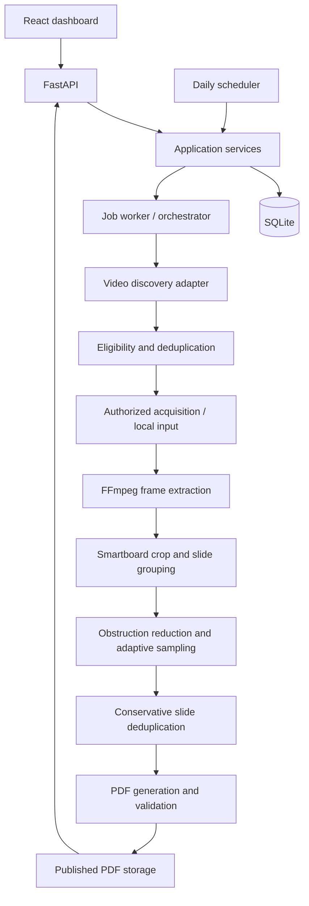

# Architecture — ytLecture2slide

Status: Phase 1 foundation, Phase 2 channel management, Phase 3 video discovery, Phase 4 video acquisition, and Phase 5 frame extraction implemented; Phase 6 smartboard processing implemented; later pipeline architecture remains proposed. Verification evidence is in docs/PHASE1_REPORT.md, docs/PHASE2_REPORT.md, docs/PHASE3_REPORT.md, docs/PHASE4_REPORT.md, docs/PHASE5_REPORT.md, and docs/PHASE6_REPORT.md.

## 1. Architecture decision

Use a modular monolith: one React UI, one FastAPI backend, a persistent SQLite-backed job queue and locally executed processing modules. Prefer explicit composition and dependency injection over microservices, message brokers or speculative abstractions. Run a single scheduler/worker owner initially to avoid duplicate execution. The API must remain responsive while heavy processing runs outside request handlers.

## 2. Logical flow



Discovery is a batch-level operation; acquisition through publication is a per-video operation. Local video jobs enter at acquisition/input validation and bypass discovery. The diagram shows logical dependencies, not separate deployed services.

## 3. Proposed project layout

```text
yt-lecture2slide/
  AGENTS.md
  README.md
  REQUIREMENTS.md
  ARCHITECTURE.md
  PLANS.md
  CHANGELOG.md
  backend/
    pyproject.toml
    app/
      api/             # HTTP routes and schemas
      core/            # configuration, logging, errors
      domain/          # entities and processing contracts
      services/        # independent processing modules
        discovery/
        downloader/
        frame_extraction/
        image_processing/
        deduplication/
        pdf_generation/
      pipelines/       # application orchestration
      repositories/    # persistence contracts and adapters
      infrastructure/  # subprocesses, filesystem, external APIs
      scheduler/
    tests/
  frontend/
    src/
      components/shared/
      features/
      hooks/
      services/
      types/
      utils/
  storage/             # runtime data; ignored by Git
  docs/
  .github/workflows/
  .env.example
  docker-compose.yml
```

Create directories only when needed. Keep domain/application logic independent of FastAPI, React and concrete external adapters. Infrastructure implements interfaces needed by application services. Avoid one interface per trivial function.

## 4. Module contracts (conceptual)

| Module | Input | Output |
|---|---|---|
| Discovery | channel identity, search policy, time window | candidate video metadata |
| Eligibility | candidate metadata, processing history | eligible/skipped with reason |
| Acquisition | authorized video reference or local path | local media descriptor |
| Frame extraction | local media, timestamps or interval | timestamped frame descriptors |
| Smartboard crop | frame, optional channel crop profile | crop or full-frame fallback |
| Slide grouping | chronological frame descriptors | same-slide candidate groups |
| Reconstruction | group, optional additional frames | selected/reconstructed image and quality flags |
| Deduplication | chronological selected images | retained images and decision metadata |
| PDF generation | selected images and source metadata | validated PDF descriptor |
| Cleanup | job-owned paths and publication status | cleanup result |

Use typed data structures for source IDs, timestamps, paths and quality flags. Pass dependencies explicitly. Image algorithms must be callable with local fixtures, without HTTP, database or YouTube access. Use subprocess argument arrays, not interpolated shell commands.

## 5. Persistence (proposed logical records)

- Channels: internal ID, canonical provider channel ID (unique when resolved), display name, URL, sample URL, enabled state, timestamps.
- Videos: provider video ID (unique per provider), channel, title, URL, publication time, duration, live status.
- Runs: trigger type, start/end timestamps, state, counts and configuration snapshot.
- Jobs: run/video reference, stage, state, attempt count, timestamps, error details and processing configuration snapshot. Enforce a unique active job per source video.
- Artifacts: job, published path, page count, file size, created time, validation status.
- Settings: typed persisted configuration with server-only secrets supplied separately.

SQLite is authoritative for job state; files are authoritative for artifact bytes. Use migrations, transactions and appropriate uniqueness constraints. Store timestamps in UTC; interpret schedules and display dates in Asia/Kolkata by default. Use transactions for job claims and keep write transactions short.

## 6. Execution and recovery

Suggested job states: queued, running, succeeded, failed, interrupted, skipped. Stage names are separate from lifecycle state. Worker claims one queued job at a time by default; prevent overlapping daily/manual batch runs using persistent coordination. On restart reconcile stale running jobs and validate existing outputs before resuming or retrying. Do not mark success until the artifact is validated and published. Reconciliation must handle crashes between filesystem publication and DB updates. Use bounded retry for transient failures; do not retry permanent authorization or invalid input errors automatically.

Storage layout (logical): `storage/jobs/<job-id>/` for temporary data and `storage/pdfs/` for published outputs. Resolve all paths inside configured roots. Write PDFs to temporary files and atomically rename on the same filesystem. Never delete user-supplied local originals. Cleanup is restricted to files created by the job. Bulk ZIP uses validated artifact paths and safe unique archive names.

## 7. Image processing strategy

Start with 60-second PNG samples at up to 720p. Detect crop/perspective only when supported by evidence. Group same-slide frames using visual similarity robust to moderate movement; request additional nearby frames at 5-second intervals only when necessary. Align frames before median/fusion; mask foreground when reliable. Evaluate results conservatively: if image processing introduces artifacts or quality is uncertain, retain usable original screenshots. Deduplicate only confidently redundant slides; preserve meaningful annotations, timestamps and ordering. MOG2, SSIM and perceptual hashes are candidate techniques, not guarantees. Tune using representative fixtures and ground truth during Phase 6.

## 8. API/UI boundaries

Planned resource groups: channels, settings, runs, jobs, artifacts, health. Use validated request/response contracts and centralized typed API access. Polling for job status/logs is sufficient initially; avoid WebSockets unless a measured need arises. Report actual counts and stages rather than invented percentages. Use feature-based UI and shared loading/error/empty components. Exact API schemas are established in the relevant phases.

## 9. Deployment and operational constraints

Docker Compose on Ubuntu, persistent mounts for DB and artifacts, writable job workspace, restricted network exposure, no secrets in frontend bundles. External requests limited to metadata and authorized media access. Use a single scheduler/worker owner in the initial deployment; scaling beyond this requires explicit design. Dependency choices: Python/uv, FastAPI/Pydantic, yt-dlp, FFmpeg, OpenCV/NumPy, scikit-image/ImageHash, PyMuPDF, APScheduler, React/TypeScript/Vite, Tailwind/shadcn. Pin compatible versions during implementation; do not assume versions or successful integration now.

## 10. Validation and open risks

Unit-test algorithms with synthetic images and short videos; test API/database/job behavior with temporary isolated storage; use mocked external adapters in routine CI. Integration-test full local media-to-PDF flow. Main unresolved risks: authorized acquisition, search recall, board readability, obstruction and false-positive deduplication, plus real throughput and disk usage. No guaranteed content recovery or performance claim until evaluated.

## 11. Phase 1 implementation decisions

- `backend/app/api` contains versioned HTTP health routes; `core` contains settings, JSON logging and centralized error translation; `infrastructure` owns SQLite and filesystem operations. `main.create_app` composes dependencies and manages lifespan. Engine/session factory instances are scoped to the application, disposed on shutdown and injectable through application state.
- Domain, application orchestration, repositories, scheduler and processing service directories are deferred until real contracts or behavior exist. The proposed layout explicitly requires directories only when needed. No empty services or speculative feature models were added.
- SQLite uses SQLAlchemy 2.x with short-lived connection/session contexts, a bounded five-second connection timeout and connection validation. Alembic shares the configured database path and empty declarative metadata. No feature schema is created in Phase 1.
- Storage defaults to `storage/jobs/{videos,frames,slides}`, `storage/pdfs`, `storage/logs` and `storage/database`. Separate typed temporary/database paths are supported. This establishes base locations only; job-owned subdirectories and path validation for user-selected inputs belong to their feature phases. Startup performs non-destructive write probes and never removes existing media.
- Frontend presentation uses React Router, TanStack Query and a typed fetch client with Zod validation. The dashboard is the first feature; shared UI states and an adapted shadcn-style Button use Tailwind v4, Radix Slot and class variance utilities. `components.json` configures subsequent shadcn additions. There are no frontend processing workflows.
- Development uses Vite's `/api` proxy; production uses an unprivileged Nginx container with the same-origin proxy. The backend has no published Docker port. An application-data volume persists all runtime data, and Compose health-gates frontend startup on database readiness.
- Existing documents place persistence and migrations in Phase 2 as well as foundation work in Phase 1. This task establishes tooling/connectivity only; Phase 2 retains feature models, revisions and channel behavior. The supplied Phase 1 task requires full Docker verification even though the older plan says “where available”; evidence is reported against the stricter task criteria.
- The initial schedule defaults and all video discovery/image-processing strategies remain future-phase requirements. Phase 1 requires no YouTube API key and installs no acquisition, OCR, AI, processing or scheduling dependencies.

## 12. Phase 2 implementation decisions

- `backend/app/domain/channels.py` isolates YouTube channel/sample-video URL normalization, validation, identity extraction from `/channel/UC...` URLs, and domain exceptions from FastAPI and SQLAlchemy.
- `backend/app/infrastructure/models.py` defines `ChannelRecord` (`channels` table) with unique constraints on normalized `channel_url` and nullable `youtube_channel_id`, managed via Alembic revision `5876ef767cd0_create_channels_table.py`. SQLite enables `PRAGMA foreign_keys=ON` on connect.
- `backend/app/repositories/channels.py` encapsulates SQLAlchemy queries, `LIKE`-escaped search over `name` and `search_keyword`, active/inactive filtering, pagination, and global summary counts.
- `backend/app/services/channels.py` orchestrates CRUD, duplicate detection, UTF-8 (including BOM and Bengali) CSV import with per-row independent validation, CSV export, and CSV template generation, using `settings.default_search_keyword` instead of hardcoded exam keywords.
- `backend/app/api/channels.py` exposes `/api/v1/channels` REST and CSV endpoints with Pydantic validation; `app/core/errors.py` maps domain errors to structured 404/409/422 responses and formats Pydantic field errors without echoing raw input values.
- `backend/Dockerfile` runs `alembic upgrade head` prior to starting Uvicorn so fresh container volumes initialize schema automatically without `create_all`; `CORS_ORIGINS` middleware permits `GET`, `POST`, `PUT`, `PATCH`, `DELETE`, `OPTIONS`.
- `frontend/src/services/api.ts` and `frontend/src/services/channels.ts` centralize Zod-validated fetch/upload/download calls; `frontend/src/features/channels/` implements summary cards, search/filter, pagination, Add/Edit/Delete/Import modals, and TanStack Query cache invalidation. No external YouTube network calls are performed during channel registration.

## 13. Phase 3 implementation decisions

- `backend/app/domain/videos.py` defines `LivestreamStatus`, `ProcessingStatus`, `VideoEntity`, `VideoSummary`, `VideoPage`, `DiscoveryRunSummary`, and discovery domain exceptions (`VideoDiscoveryError`, `QuotaExhaustedError`, `ChannelResolutionError`, `DiscoveryAlreadyRunningError`).
- `backend/app/infrastructure/youtube_client.py` implements a lightweight, synchronous `YouTubeApiClient` using `httpx` (avoiding `google-api-python-client` SDK bloat) with bounded exponential backoff retries on 429/5xx/network timeouts, internal quota tracking (`search.list`=100, `channels.list`=1, `videos.list`=1 per 50-item batch), and `__repr__` key masking.
- `backend/app/infrastructure/models.py` adds `VideoRecord` (`videos` table) with unique `youtube_video_id` and nullable `channel_id` foreign key (`ON DELETE SET NULL`) so channel deletion never destroys video processing history, managed via Alembic revision `f4fbd26e2e58_create_videos_table.py`.
- `backend/app/repositories/videos.py` provides `create_or_skip` (preserving existing `processing_status` on repeat discovery), filtered/sorted/paginated listing, and summary queries (`total`, `pending`, `today`, `latest_discovery_at`).
- `backend/app/services/discovery.py` orchestrates channel ID resolution (`/channel/UC...`, `/@handle`, `/user/name`, `/c/name`), persists newly resolved IDs on `ChannelRecord`, applies the 7-day UTC lookback window, ISO 8601 duration filter (`> 1201s` via `isodate`), ownership verification, upcoming/live livestream deferral, and an in-process thread lock to prevent overlapping discovery runs.
- `backend/app/api/videos.py` exposes `/api/v1/videos` and `/api/v1/discovery` routes; `app/core/errors.py` maps `QuotaExhaustedError` (503), `DiscoveryAlreadyRunningError` (409), `VideoDiscoveryError` (422), and missing `YOUTUBE_API_KEY` `ValueError` (422).
- `frontend/src/services/videos.ts` and `frontend/src/features/videos/videos-page.tsx` implement Zod-validated video/discovery API calls, summary cards, IST (`Asia/Kolkata`) timestamp formatting, duration formatting, status badges, search/status/sort/pagination controls, and manual "Discover Videos" triggering with TanStack Query cache invalidation.

## 14. Phase 4 implementation decisions

- `backend/app/domain/downloads.py` defines `DownloadStatus` (`pending`, `downloading`, `downloaded`, `failed`, `cancelled`), `DownloadProgress`, `MediaProbeResult`, `DownloadRequest`, `DownloadResult`, `BulkDownloadSummary`, `VideoDownloaderAdapter`, `MediaProbeValidator`, and download domain exceptions.
- `backend/app/infrastructure/ytdlp_downloader.py` isolates `yt_dlp.YoutubeDL` behind `VideoDownloaderAdapter`, enforcing video-only streams capped at `DOWNLOAD_MAX_RESOLUTION` (default 720p), disabling playlists/subtitles/metadata files, sanitizing YouTube IDs against path traversal, supporting `.part` resume (`continuedl=True`), distinguishing connect/inactivity/optional-total timeouts, and honoring separate user cancellation vs. shutdown interruption events in progress hooks.
- `backend/app/infrastructure/media_probe.py` implements `FFprobeValidator` using cancellation-aware subprocess argument arrays (stabilized in Phase 5) to verify video stream presence, resolution bounds (`height <= max_resolution`), positive duration, codec metadata, non-zero file size, and absence of audio streams.
- `backend/app/infrastructure/models.py` and Alembic revisions `91dda657a047_add_video_download_columns.py` and `b0f3f4fb90a4_add_download_byte_tracking_and_recovery_.py` extend `videos` with `download_status`, `local_video_path`, `actual_resolution`, `file_size_bytes`, `video_codec`, `download_progress`, `downloaded_bytes`, `total_bytes`, `download_requested`, `download_started_at`, `download_completed_at`, `download_retry_count`, and `download_error`, keeping `download_status` independent of `processing_status`.
- `backend/app/services/downloader.py` (`VideoDownloadService`) executes downloads asynchronously on a bounded `ThreadPoolExecutor` (`DOWNLOAD_CONCURRENT_LIMIT=1`), throttles SQLite progress/byte updates, marks transient live speed/ETA separately from persisted progress (`is_live`), prevents concurrent operations on the same video and duplicate downloads, checks disk space before and during downloads, performs bounded exponential-backoff retries on transient errors, deletes invalid files if FFprobe validation fails, preserves `.part` files on `SIGTERM`/shutdown and automatically recovers interrupted/pending downloads on startup (without restarting cancelled downloads), and safely deletes local files inside `DOWNLOAD_DIR`.
- `backend/app/api/videos.py` exposes non-blocking `POST /api/v1/videos/{id}/download`, `POST /api/v1/videos/downloads/bulk`, `GET /api/v1/videos/{id}/download/progress`, `GET /api/v1/videos/downloads/active`, `POST /api/v1/videos/{id}/download/cancel`, `POST /api/v1/videos/{id}/download/retry`, and `DELETE /api/v1/videos/{id}/download`.
- `frontend/src/features/videos/videos-page.tsx` adds row/bulk selection, download/cancel/retry/delete-with-confirmation actions, actual resolution and file size display, error display, and TanStack Query polling (`1500ms`) active only while downloads are running.


## 15. Phase 5 implementation decisions

- Extraction domain contracts are independent of FastAPI, YouTube, SQLite and React.
  `FFmpegFrameExtractor` accepts local paths, ranges or explicit timestamps, a callback
  and a cancellation signal. The adapter reuses FFprobe source validation.
- Sparse input seeking is the default following an authorized lecture benchmark:
  35.15 seconds versus 276.33 seconds for sequential decoding of the same 5179-second
  AV1 lecture. Both produced 87 original-resolution frames. Sequential decoding remains
  configurable for dense sampling; very large explicit expressions fall back to seeking
  to avoid OS argument limits. Source PTS is derived from integer ticks and rational
  time base rather than rounded FFmpeg log timestamps or assumed requested times.
- Each generation is isolated under the database video ID. Exclusive output ownership,
  source identity checks, streamed PNG CRC/decompression validation and an atomic
  manifest prevent silent overwrite or false success. A validated older generation
  remains intact if a later attempt fails. Interrupted generations are preserved.
- The `extractions` table has a video-ID primary key and independent lifecycle fields;
  it does not change download or processing status. SQL conditional updates claim jobs.
  Alembic revision `6ca8f2d915ab` owns the new table. Progress writes are throttled.
- A bounded executor uses the Phase 4 persistent requested/recovery pattern. Shutdown
  terminates subprocesses and keeps pending intent; startup respects retry limits and
  reconciles complete manifests before decoding. Explicit cancellations clear intent.
  Transient OS resource errors use bounded exponential backoff. Incomplete generations
  are retained and extraction restarts in a new generation rather than appending files.
- Download start/deletion and extraction operations share a reentrant media-operation
  lock, closing the validation/deletion race in the supported single-owner deployment.
  Multiple independent backend owners remain unsupported, as in Phase 4.
- Frontend extraction services use Zod and the centralized API client. Row controls use
  TanStack Query and poll only requested jobs. The reusable preview paginates 12 lazy
  screenshots with requested/actual timestamps and original-resolution links.
- Compose places frames in the existing persistent application-data volume. No new
  runtime dependencies, processing frameworks, scheduler or later-phase algorithms
  were introduced. Benchmarks and verification details are in docs/PHASE5_REPORT.md.

## 16. Phase 5 stabilization decisions

- The backend image contains digest-pinned Deno 2.5.6 for Linux ARM64/AMD64 and locked
  `yt-dlp-ejs==0.8.0` matching yt-dlp 2026.11.23. Runtime selection/path are typed settings
  passed explicitly to the acquisition adapter; remote components are disabled. The
  [official EJS documentation](https://github.com/yt-dlp/yt-dlp/wiki/EJS) explains the missing
  runtime/solver dependency behind the earlier Docker compatibility gap. Upstream errors
  are translated to actionable messages without exposing signed URLs or credentials.
- `infrastructure.processes` factors the existing FFmpeg termination behavior into a shared
  process-group lifecycle. FFprobe uses polled communication with timeout, cancellation and
  shutdown checks; both media tools terminate gracefully then forcibly and are reaped.
  Download validation receives distinct cancellation/shutdown signals. Extraction uses its
  combined signal and the service retains the existing cancellation/recovery distinction.
- `services.storage_cleanup.StorageCleanupService` receives authoritative state/active
  callbacks and the owner's shared reentrant lock. Startup and extraction completion run
  it synchronously without a scheduler or schema/API changes. It opens all directory
  components with `O_NOFOLLOW`, scans only numeric video IDs and UUID generations, refuses
  unknown content, and removes files via directory descriptors. Per-file accounting is
  streamed; database state is read once per video without cleanup writes.
- Default retention is 48 hours for abandoned intermediates. Active/requested jobs,
  published manifests, referenced output and the newest failed attempt are protected.
  Dry-run returns predicted counts/bytes; applied cleanup reports actual unlinked logical
  bytes, file and generation counts plus errors. Successful output and source retention
  take priority over reclaiming maximum space.
- Incremental incomplete-generation recovery is deferred intentionally: no persistent
  frame checkpoint associates each partial PNG with verified PTS and source/configuration
  identity. Introducing that protocol for seek and sequential paths is disproportionate
  to the measured roughly 30-second restart cost. Complete validated manifests remain
  reusable; mismatched/corrupt/incomplete generations cannot be mixed into a result.
- The single backend owner, throttled progress, sparse seeking, PNG output, SQLite claims
  and existing HTTP contracts remain unchanged. No Phase 6 processing is implemented.

## Phase 6 implementation

The existing monolith now includes `domain/slides.py` (validated configuration, state,
manifest and decisions), `services/imaging/` (board geometry, complementary similarity,
foreground hypotheses, observed-pixel reconstruction and independent processor),
`repositories/slides.py` (conditional transactional claims), `services/slides.py` (bounded
background jobs/recovery) and `api/slides.py` (HTTP/preview boundary). Composition remains in
`main.py`; the FFmpeg adapter is injected into `SlideProcessor`. Modules run without HTTP,
SQLAlchemy, YouTube or a worker. Persistence uses migration `ab61c4ea9012` and a separate
`slide_processing` table. No overall video processing or download API status was repurposed.

A shared media lock guards slide, extraction and download mutations. Slide intent is claimed
before enqueueing; original extraction deletion and source mutations are blocked while queued
or active. Bounded cancellation signals reach image loops and FFmpeg. Startup recovery has a
retry cap and restarts into isolated generations; explicit cancellation clears durable intent.
Only transient resource errors are retried with exponential backoff. Per-request overrides
merge into validated channel/server defaults; the resulting configuration persists for retry.

Images are processed incrementally, with at most five fusion observations by default.
Candidates use SSIM, edge overlap, original-resolution change fraction and descriptive DCT
hash distance. Groups are chronological candidates, never proof of semantic identity. Original
and processed predecessors must both be near-identical to exclude a primary frame. Fusion
also requires alignment and stable visible content/annotation evidence, then two agreeing
visible observations per replacement. Median is an independently callable alternative;
default fusion copies observed pixels. Small Gaussian smoothing is used only for the noise
comparison gate, never to generate fused educational pixels. Full-frame/original fallbacks
retain ambiguity. Every primary gets a retention/exclusion decision. No original is deleted.

Atomic JSON is the generation completion marker; the database publication pointer changes
only after PNG/manifest validation. Old successful generations survive failures. Previews
carry generation IDs to reject stale listing/image combinations. Image filenames are schema
restricted and API allowlisted. Recursive deletion uses no-follow directory validation and
file-descriptor-relative, symlink-resistant removal; unknown video-directory entries abort
removal. Sources and extraction generations live outside the deletion root.

Known deliberate limits: masks do not verify teacher identity or permanent visibility; the
current evaluated lecture has all outputs flagged for manual review. The bounded default
budget is consumed early rather than promising whole-video adaptive coverage. No scene-cut
search or dense full-video completeness scan is performed. Physical source PNG copies in the
comparison generation cost storage but decouple successful previews from later frame deletion.


## Phase 6 Optimization & Stabilization

- Added `channel_board_profiles` table (Alembic revision `c3d8e1f2a4b5`) and `ChannelBoardProfileRepository` to persist normalized per-channel crop/perspective profiles, automatically reuse them on subsequent videos from that channel, and validate aspect ratio and edge structure before applying (falling back to full frame on layout changes).
- Separated chronological slide segmentation (`compare_visible` in `services/imaging/similarity.py`) from representative selection: compares mutually visible board regions (excluding joint 2-frame foreground masks), inspects 4×4 grid cells, detects newly added annotation/answer strokes, and checks both segment anchor and previous frame to prevent transitive drift.
- `select_best_or_reconstruct` (`services/imaging/reconstruction.py`) ranks candidates by visible board coverage and visible-region sharpness/contrast, selecting `clear_original` or `improved_original` directly when obstruction is below `clear_obstruction_threshold` (3%) and invoking observed-pixel fusion only when needed.
- `backend/app/domain/exclusion.py`, `backend/app/services/exclusion.py`, `backend/app/repositories/settings.py`, and `backend/app/api/settings.py` implement persistent Unicode-aware English/Bengali video exclusion keywords (`app_settings` and `videos.is_excluded` / `matched_exclusion_keywords` via Alembic revision `d4e5f6a7b8c9`), automatic classification during discovery, reevaluation on keyword updates, and backend enforcement across downloads, extractions, slide processing, bulk requests, and startup recovery.
- `SlideProcessor` and `SlideService` enforce full-frame processing (`full_frame_board`, `reliability="full_frame"`), ignoring saved `channel_board_profiles` and crop/perspective overrides while retaining the table for backward compatibility.
